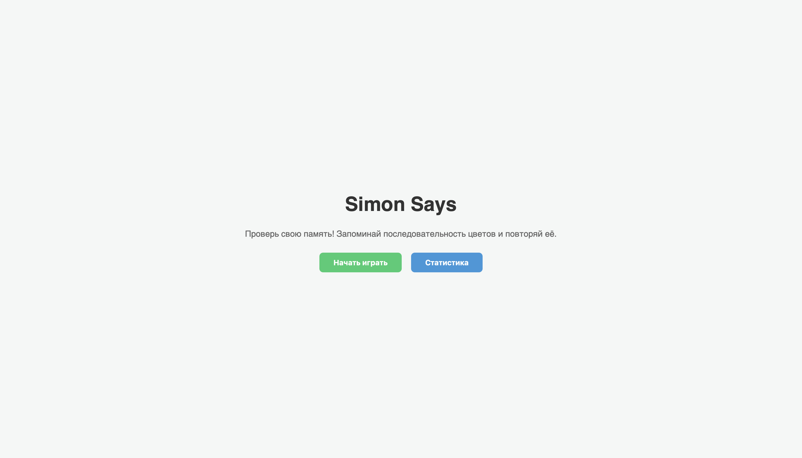
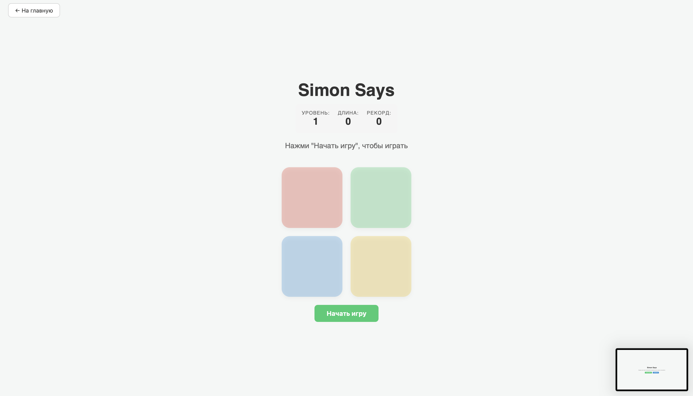
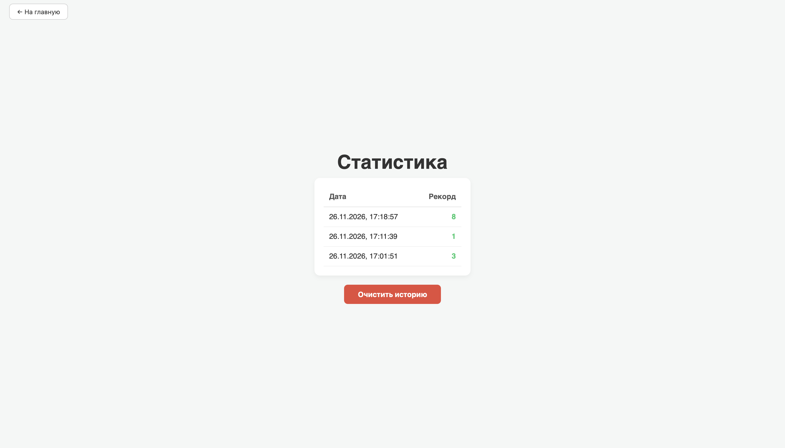

# Лабораторная работа №5 — Simon Says на React

Проект представляет собой веб-приложение — игру на память «Simon Says», разработанное на React и TypeScript. 

Приложение состоит из двух частей:
1. **`ui-library`** — библиотека переиспользуемых UI-компонентов (панель кнопок `SignalPanel` и индикатор `ProgressIndicator`).
2. **`frontend`** — многостраничное веб-приложение с клиентским роутингом, использующее компоненты библиотеки.

## Функционал

- **Главная страница**: приветствие и навигация.
- **Игра**: генерация случайной последовательности, визуальная подсветка кнопок, повышение уровня сложности, блокировка ввода во время показа.
- **Статистика**: сохранение результатов (дата и рекорд) в `localStorage` и вывод их в виде таблицы.

## Запуск проекта

Установите зависимости и запустите проекты. Все команды выполняются из корня папки (`simon-says-coursework`).

### Шаг 1: Сборка UI-библиотеки
```bash
cd ui-library
npm install
npm run build
```

### Шаг 2: Запуск фронтенда
```bash
cd ../frontend
npm install
npm run dev
```
Приложение откроется по адресу `http://localhost:5173`.

## Тестирование и линтинг

В обоих проектах настроены Jest и ESLint. Вы можете проверить каждый проект отдельно, перейдя в его папку (`ui-library` или `frontend`):

```bash
npm run lint
npm run test
npm run test:coverage
```

## Скриншоты работы

### Главная страница


### Игровой процесс


### Статистика


